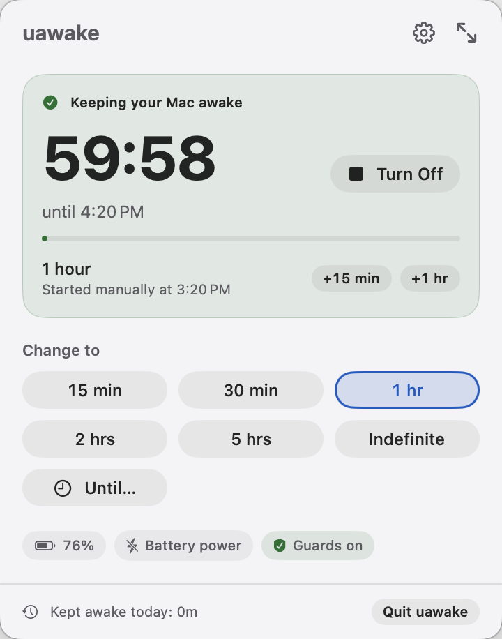
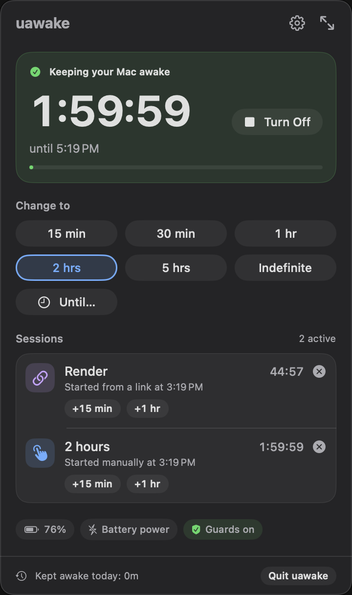
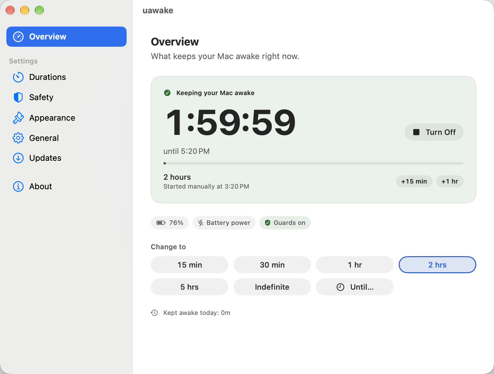

# uawake

**uawake — keep your Mac awake.**

A free, open-source macOS menu bar app by Underscore Technology. Click once to keep your Mac
awake, for as long as you need, and uawake tells you what is keeping it awake and why. Safety
guards stop sessions at low battery, in Low Power Mode, when your Mac gets too warm, or after a
maximum duration.

**Status:** 0.1.0, first public alpha (not yet released). MIT licence.

<p>
  
  
</p>


## Features (0.1)

- Keep the Mac awake indefinitely, for a preset or custom duration, or until a time of day.
- Several sessions at once, each with a reason you can see in `pmset -g assertions`.
- Optional display-awake mode, countdown in the menu bar, and a global shortcut.
- Safety guards: battery limit, Low Power Mode, thermal pressure and a maximum duration, all on by default.
- Notifications before a session ends (with Extend and Stop) and when a guard stops one.
- Pauses for fast user switching; carries on after the Mac wakes.
- `uawake://` URL scheme for scripts and automation.
- Every setting is a documented preference key ([docs/SETTINGS.md](docs/SETTINGS.md)), ready for MDM management in 1.3.

Requires macOS 14 Sonoma or later, on Apple silicon or Intel.

## Install from source

Signed downloads and a Homebrew cask arrive with the first public release. Until then:

```sh
brew install xcodegen          # Xcode 26 or later is also required
git clone <repository URL> uawake && cd uawake   # TODO: URL once the GitHub organisation is decided
make build                     # or: make release (an unsigned DMG for local testing)
open build/DerivedData/Build/Products/Debug/uawake.app
```

If the menu bar is full and the uawake icon is hidden, open uawake again from Applications or
Spotlight: it shows its window.

## URL scheme

| URL | What it does |
| --- | --- |
| `uawake://activate` | Keep awake until you turn it off |
| `uawake://activate?duration=1h30m` | Keep awake for a duration: `h`, `m`, `s` parts in that order (`45s`, `90m`, `2h15m`) |
| `uawake://activate?until=18:30` | Keep awake until a time (24-hour `HH:mm`; tomorrow if it has passed) |
| `uawake://activate?display=1&reason=Render` | Also keep the display awake; name the session |
| `uawake://deactivate` | Stop all manual and URL sessions |
| `uawake://toggle` | Stop manual and URL sessions if any run, otherwise start the default session |

From Terminal: `open "uawake://activate?duration=2h&reason=Build"`. Invalid URLs change nothing.

## Privacy

- No analytics, telemetry or tracking. Nothing about you or your Mac leaves it.
- The only network traffic is the update check (Sparkle), which you can turn off.
- uawake does not use the camera or microphone. From 1.0, an optional "On a call" rule will use
  the camera entitlement only to detect whether a camera is in use; it never reads video.
- Session history (from 1.2) stays on your Mac.

## Development

`make generate`, `make build`, `make test`, `make uitest`, `make lint`, `make screenshots`,
`make release`. See [CLAUDE.md](CLAUDE.md) for the project guide, [docs/SPEC.md](docs/SPEC.md)
for the product spec and [docs/CONTRACTS.md](docs/CONTRACTS.md) for the core contracts.

## Credits

Created by Abhijit Roy · Underscore Technology. Inspired by KeepingYouAwake; uawake is an
independent, clean implementation that shares no code with it.

## Licence

MIT. See [LICENSE](LICENSE).
